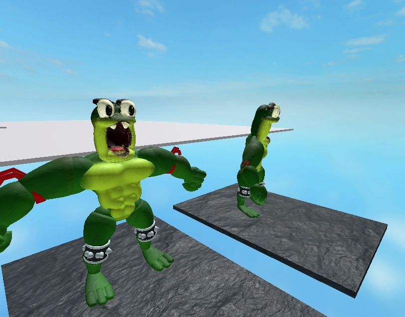
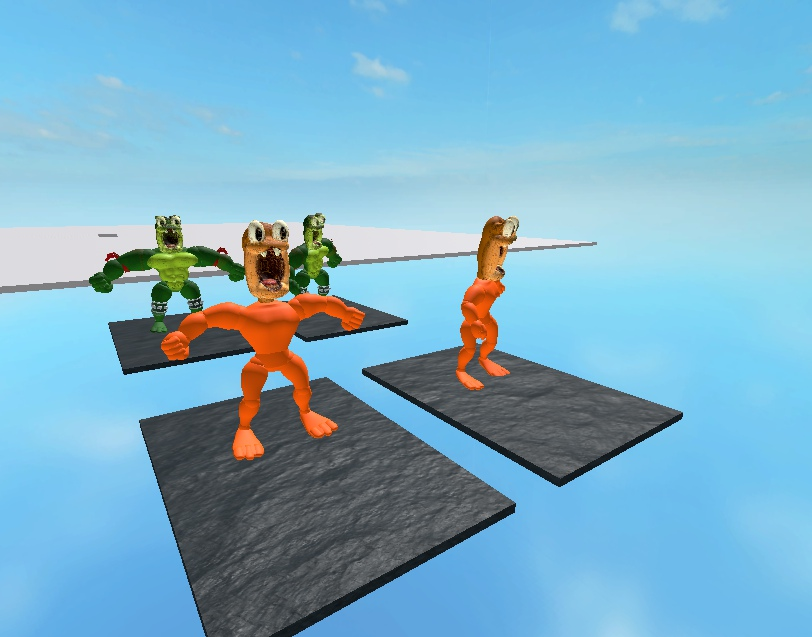
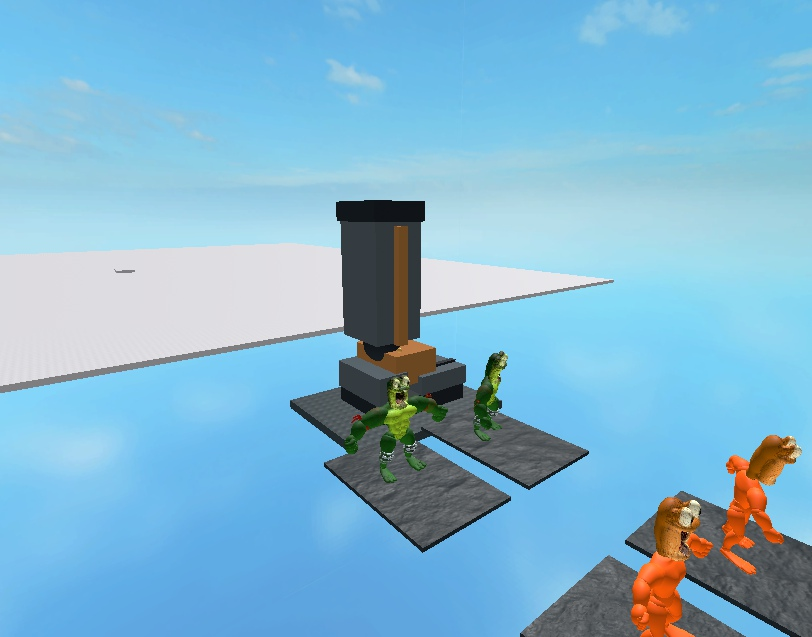

# First Guardian appearance and hero fear — 9 November 2026

The first-route Guardian now has a finite, party-owned introduction before its existing battle pattern activates. Source graphics32/33 select real fear-head meshes on Green/P2, with authored body poses. Two impacts, the giant intro-foot reference and the E0 camera cut follow the verified source counter. They create no damage, healing, shields, respawns, input lock or player trajectory assistance.

## Source and interpretation

The pinned source and exact references are in [the animation research](../../research/2026-11-09-canonical-character-animation-source.md). Counter01..DF requests animation2C/graphic32; impacts occur at30/64; foot12 begins50; E0 performs the arena perspective cut and keeps the previous fear write; E1..FE requests2E/33; FF removes intro context and activates the existing Guardian once. Skipped counter events are collected once by the existing canonical query.

The source helper masks its animation pointer with7 rather than restarting it. This implementation carries that provenance and the verified graphic phases; it does not claim a byte-for-byte NES animation-pointer or physics emulator. The local60Hz/4.25s calibration, three-hero extension, 3D facial anatomy/joint angles, foot trajectory, ripples and camera placement are authored adaptations. Source fear velocity opcodes do not move the Roblox body. The14-piece mechanical foot and two ripple markers are cosmetic3D proxies, not the finished canonical boss mesh. Original boss music/impact audio and complete body deformation remain unfinished.

## Frozen assets and packaging

- One Model upload through Studio MCP/Open Cloud: **94539676546833**; automatically imported albedo atlas **84359931596705**. Actual four mesh IDs, texture IDs, native MeshSize/InitialSize and attachment transforms are in [roblox-fear-morphs.json](../../assets/characters/canonical-hero/roblox-fear-morphs.json).
- `hero-fear-morphs.glb`: **6,193,776bytes**, SHA256 **ba7f9650dba2c0425db6ab0a3dc9f45041936c2eb798314864d0a8f93ac1e39a**. Four closed head shells;45,922 triangles total, maximum12,334/37,002 UV vertices per mesh. One baked albedo, no COLOR_0/emissive. Official Khronos validator:0 errors/0 warnings/0 infos.
- Import normalization removed placement offsets and arbitrary package yaw while retaining the mesh's imported local rest rotation. All four measured centres/dimensions were checked independently; Green/P2 centres are different. Maximum raw centre residual was5.34e-7 studs; normalized joint-origin position residual3.01e-8 studs.
- The private morph folder now contains exactly eight resources: four attack forms plus four fear heads. A fully equipped Green/P2 cosmetic rig has **19 MeshParts/19 Motors**, alongside the existing six physical R6 Motors. Forms are preassembled before server ownership; playback changes visibility and cosmetic joint poses.
- Source fingerprint **a9a7efd51486d814d2cf35ffefb9170b94456e49bb08d626008e9cd8c52459ca**. Playable **744,382bytes**, SHA256 **a20b157339a40161f387a3bdab95703a249df205b5a3cb36d340a3b81f031f03**. This exact file was reopened in fresh Studio.
- All five earlier GLBs remain unchanged. The user's dirty `places/BrickToads.rbxlx` remains byte-identical at **1974f25e1af043f3d4a1fe581b5ec9ac818394ac4bc7a747e6fe0ca1f7b5c353** and is excluded from this change.

## Verification

`final-validation.json` records **45 successful native/Python/build commands** and compilation of **123 Luau files**. Focused checks include13 intro lifecycle/World tests,18 source hero-presentation tests, four new fear appearance contracts, current actor/group/camera contracts and25 packaging tests. RED/GREEN checks demonstrated missing intro behavior, source fear selection, shared-head transition failure and missing-family packaging before their fixes. Independent review found no actionable P1/P2 issue in the reviewed change.

Two separate prepared native scenarios are recorded in `studio-engine-evidence.json`. They use real Session/Director/World modules; fixture-only actor placement, support floor, direct HP preparation and manually advanced intro timestamps are explicit. They are not normal player-input route acceptance.

- Three heroes followed counters1/48/80/100/224/225/254/255: fear32 persists at E0, fear33 follows, and FF restores ordinary heads, deletes intro props and enters Boss exactly once. No boss existed during the intro. The prepared Human assignment999 was retained on activation; this does not test a real human transport connection.
- The prepared hero's physical HP37, other heroes'100, raw Life47, attempt1 and three respawns remained unchanged. HP37 was set directly for this cosmetic preservation probe; it is not a new combat-damage test. Captured samples retain manual server network ownership and the physical assembly root.
- A separate native scenario verified reaction, an actual jump/Airborne, landing, cancellation and physical-body replacement. Cancellation restores the normal head. A replacement body does not inherit the captured old actor's fear; its new health follows the existing spawn rule. Exact nonzero shared-head transparency restoration is additionally covered by the native contracts.
- A second party's World context, hero forms and props remained unaffected.
- Direct native client calls to the real camera helper produced distinct pre-cut/E0 transforms; other-party, stale-run, free-view and ended-context probes returned false. This verifies helper behavior, not a full ordinary-input cinematic or physical-phone camera review.

The saved images separately show **Edit-time native geometry with the real sampled32/33 poses and Motor6D transforms**, plus the real World foot helper at counter100. The initial immediate Edit capture was blank while resources loaded; the saved images were taken after loading. They do not prove cold first-frame loading in gameplay.

## Remaining work

These are head-only forms on the existing bodies. Full fear body silhouettes, source airborne/Z mapping, remaining attacks/reactions/death forms, finished P2/Brown/enemy/boss art, boss music/audio, normal-input traversal into and through the encounter, physical mobile devices, cold loading/performance, multiplayer/reconnect, all13 modes/six complete bosses and public release are not accepted by this checkpoint. The separate public BrickToads experience is still unpublished. BT-14 and BT-62 remain In Progress.
