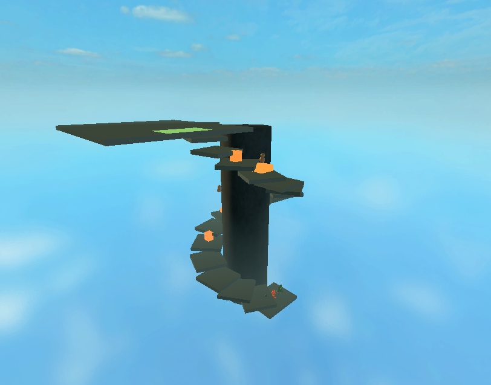

# Campaign mechanics checkpoint — 9 November 2026

The server now connects thirteen authored stages into one fixed-roster run. The first six-district causeway and Guardian remain intact. Twelve later stages implement rope descent/swing/kicks, speeder riding, ice inertia/pushable blocks/moving hazards, surfing, four moving-serpent rooms, jet flight, lifts/fans/electrical ascent, dry/swim/current/air transitions, physical rat/bomb racing, directional Clinger pursuit, a rotating cylindrical tower and the final arena. Five additional bosses join the existing Guardian. Stage objectives and boss outcomes gate progression; an elapsed timer cannot award a course win.

These are implemented Roblox adaptations. Course layout, counts, seconds, studs, trajectory tuning and later procedural silhouettes are authored. Source Life arithmetic and measured behaviors are distinguished from unknown parity in the four [campaign research notes](../../research/2026-11-09-campaign-courses.md), [bosses](../../research/2026-11-09-campaign-bosses.md), [enemies](../../research/2026-11-09-campaign-enemies.md) and [race rival](../../research/2026-11-09-campaign-race.md). This report does not certify a finished canonical cast or public release.

## Exact saved artifact

| Item | Receipt |
| --- | --- |
| Playable | `places/BrickToadsPlayable.rbxlx`, 1,017,596 bytes |
| Place SHA-256 | `1769ecbaa4df2371da6dd42604235af655b2bd52c8d548737aa549b97a5c962e` |
| Embedded source SHA-256 | `38bda09a769a7b405b8bc7705a00337956c9164fd55a60e04b26af7d9981d4a1` |
| Embedded scripts | 50; 31 gameplay modules |
| Protected user starter | `1974f25e1af043f3d4a1fe581b5ec9ac818394ac4bc7a747e6fe0ca1f7b5c353`, unchanged and excluded from staging |
| Previous models | All seven previous GLBs and the active wide-mouth package preserved; frozen-asset checks pass |

## Automated verification

[Full JSON](final-validation.json) and [command output](final-validation.txt) record **55/55 passing commands** and **157 successful Luau compilations**. This includes rebuilding/checking the saved playable, existing lifecycle/combat/presentation regressions, all new campaign runners and native-world API-double contracts. Sources were inventoried before/after and did not change during verification.

The new coverage includes source-sized ordinary Life, Raven/dead-bird/claw reactions, guarded Invader steal/return, finite projectiles and obstruction casts, shared vehicle retry, scripted encounter replay identities, real rival movement/bomb contact/stun, five boss FSMs and same-body human controls, and resource-preserving campaign transitions. Separate tests cover control axes, camera framing and localized role/objective feedback.

Thirty normal-input course pilots exercise ten traversal modes at seeds 1, 41 and 8125 through the real Session against an API-double world. They spend no respawns; they do not write health/position/lives inside the pilots. These are **course-only automated pilots**, not native whole-campaign playthroughs. The full thirteen-stage controller transition test also uses controlled stage outcomes. A separate real Session attack test earns the final boss result.

## Roblox Studio acceptance

The exact saved file above was opened in owned helper process8452, Studio `4fd51edb-4a48-49c3-8c0f-65f35fe32d2c`. All receipts below report the matching embedded source fingerprint. The helper was cleaned, stopped and closed afterward. The user's original process24008 remained open.

The checked-in [fixture](studio-campaign-fixture.luau) is acceptance code only, absent from production. It instantiates actual Session, Director, World, enemy and boss modules in an isolated world at Z4096, with an explicit selected roster/seed and controlled clock. [Native results](studio-native-acceptance.json) confirm:

- All twelve new modes construct and step with three actual hero bodies, support geometry and the expected real actors.
- A swept native projectile cast stops at a thin wall and at an initial overlap, while a clear segment remains clear.
- A Snowman claimed before its first AI step retains its original body, server ownership and movement/reaction-recovery speed4.
- A prepared transition preserves surviving actor IDs/attempts/stocks and the offline teammate, heals living survivors once, leaves the eliminated teammate eliminated and rejects the old level epoch.
- Big Blag, Robo-Manus, General Slaughter, Buzzball and Dark Queen accept their first real boss action and return to Ready on the same body after a finite attack/recovery interval. Robo-Manus still has finite active projectiles at the three-second observation point; this is not a claim that every projectile has already expired.
- One-second real-clock engine probes move the rope, ice and race hero using valid movement intents. They are short movement probes, not full courses.

[Additional native results](studio-native-victory-vehicle.json) confirm two prepared boundaries:

- **Final victory:** only entrance/stance positions were prepared. Twenty-seven accepted hero attacks, actual collision queries and the real SourceCombat/Session path advanced Dark Queen to progress240 and defeat. No boss Life/progress/death state was written. The same boss body remained; hero Life47, attempt1 and all three respawns survived. This stationary human-owned boss fixture is not a naturally played final encounter.
- **Shared vehicle crash:** the entry foot patrol was explicitly removed for isolation, boarding used validated Punch intents and one rider was positioned at an existing authored hazard. The real collision/death lifecycle stopped the group, rewound it and resumed Riding once. Only the collided rider became attempt2/respawns2; the other retained its original body, attempt1, Life47 and respawns3.

The image is an overview of the native prepared tower, not a final-art or player-camera acceptance image. Capturing immediately after construction preceded dynamic-part replication; the saved image was captured after those parts arrived.

## Original Studio synchronization

Before mutation, all42 existing original Studio scripts were compared **exactly by source chunks** against baseline commit `727098f8ca1393ae0e3059189838f7d063d810c6`; all matched. Twenty-four updated/new sources were staged, then applied:16 existing scripts updated,8 campaign modules added. All50 final sources and classes were compared exactly against the saved playable in21 verification batches. Temporary staging was removed. Original Studio `67cde5d7-c587-4240-9f6f-ef46082fa9bc` remains in Edit with the new sources. Its cached Edit-time module returns are not used as evidence. The dirty user starter file was never saved or staged.

## Remaining acceptance boundaries

No full natural human playthrough of the current thirteen stages, real phone/tablet multitouch/performance test, actual reconnect, or public release was performed. Those remain open. Later cast/vehicles/bosses use distinct procedural presentation; full canonical art/animation, remaining source-exact FSM/input details, audio and final effects remain unfinished. Guardian and hero presentation retain their separate earlier asset receipts. No auto-navigation was added to player controls, and no test helper or artificial victory is shipped in the game.
