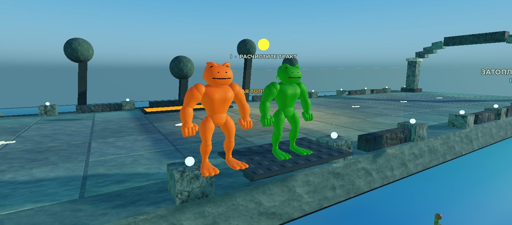

# Canonical character pipeline — 9 November 2026

The playable now clones the real imported fifteen-part Green/P1 and orange-brown P2 prototypes onto the existing server-owned R6 body. The first neutral models remain prototypes; the owner's newer muscular brawler description is the next visual revision. No character or full-game completion is claimed.

## Verified

- Both GLBs passed official Khronos validation with zero errors/warnings and were uploaded through the owner-approved MCP folder. Private Model assets: P1 `128871683590726`, P2 `110833474840144`; both Approved/Active. These are model assets, not a published game.
- Actual imported mesh IDs, scale, CFrames, colours and 28 attachment transforms per hero are saved in `assets/characters/canonical-hero/roblox-player1.json` and `roblox-player2.json`. Independent binary/transform checks agree with authored dimensions within `1e-4` stud.
- Native prepared `World:spawn` fixture: both heroes have 15 cosmetic meshes/15 motors, noncolliding/massless parts, original physical assembly root, manual server ownership, unchanged health. Walk16, Run24 and running jump observed; maximum joint separation under `2e-5` stud. Presentation retained test health37 while the other hero stayed100. Replacing one body destroyed only that body and retained server ownership.
- Native desktop mouse click on the ordinary menu started P2 with `CanonicalNESHero`; no direct Start remote was injected. The first coordinate attempt selected P2, then the corrected click included Roblox's58px GUI inset. Source receipt: `8f36c327f1e1a6ddb4c901ea034bdad99495f88bf04cccde1232fea41bdffc94` (37 scripts). Console showed no runtime exception in that production-start check.
- Frozen verification: 41 native/Python/build commands and Luau compilation passed; exact results in `final-validation.json`/`.txt`. The user's `places/BrickToads.rbxlx` remained unchanged.
- Pure source-domain modules cover69 animation streams and the traced Tall Walker articulated renderer. Native animation16 and Walker6 test groups pass; independent Walker sweep matched1,382 accepted poses to literal ASM.

## Remaining acceptance

The neutral source-palette prototypes use the existing inferred R6 presentation. Source-driven authored3D poses, enlarged fist/boot shapes, fear32/33 and the real boss appearance/camera sequence are not complete. The owner's new sunglasses/red bands/spiked knee cuffs/massive lime-front brawler revision is being authored separately; it is not represented by this screenshot.

Tall Walker's five-node GLB and source leg contract are authored/validated locally; cloud import and game binding remain pending. Other character families, third hero adaptation, all13 modes/six bosses, full normal-input route, real multi-client/reconnect, physical phone/tablet readability, performance budgets and public-experience asset permissions remain open. No public production release was performed.
