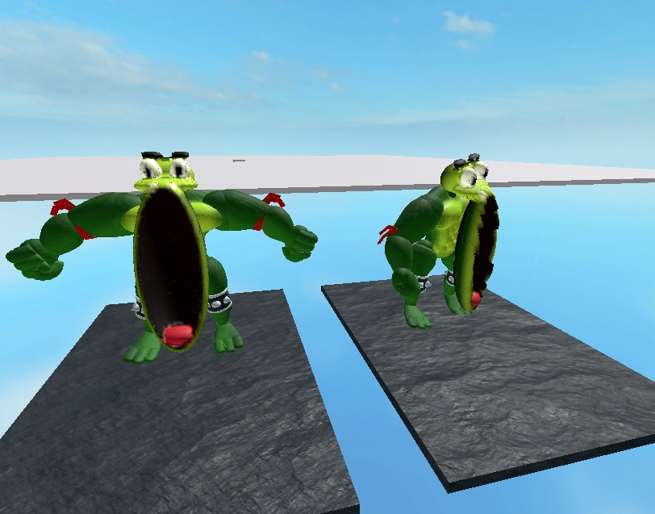
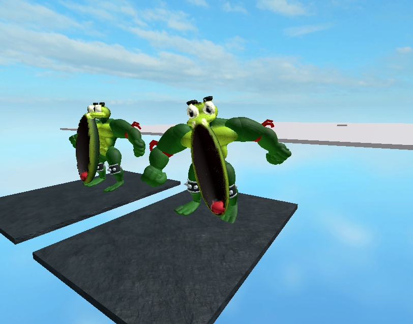
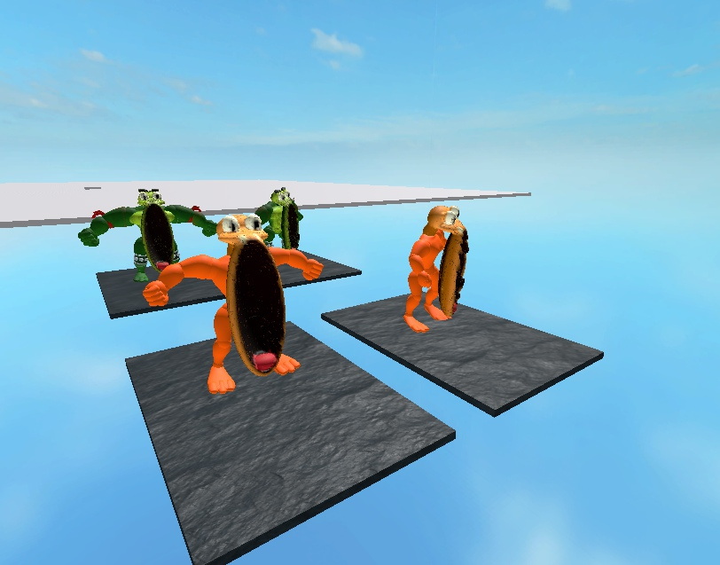

# Exaggerated fear-mouth correction — 9 November 2026

The owner supplied an original-game frame showing a much larger, downward-opening mouth. The previous fear mesh mostly stretched the head upward and kept the chin near neckY−.2. The active Green/P2 forms now drop the jaw to about−4.24 while keeping the skull/eyes lower: the mouth reaches almost to the feet in the existing32/33 poses.

## Changed asset, unchanged gameplay

- New `hero-fear-wide-mouth.glb`: **8,712,432bytes**, SHA256 **e5dd859b9be454198046580a147f7d202fd5374502f0f860384d1590efa325c1**. One Model upload **127590624870763**; imported albedo **96845591138258**. The active [fear manifest](../../assets/characters/canonical-hero/roblox-fear-morphs.json) points to these resources.
- Four semantic names, neck origins and profiles stay the same. Triangles16,630/18,066/16,208/17,574; UV vertices49,890/54,198/48,624/52,722. Each is one closed connected outward shell with one primitive/shared albedo; no COLOR_0/emissive. Official Khronos and independent checks report zero issues.
- Nominal opening height **4.73studs**, widths1.27 Before /1.65 After: approximately **3.02×/3.48×** the earlier opening. Green Before minimumY drops from−.200 to−4.243, while maximumY decreases from2.882 to1.803. It is downward jaw extension, not an enlarged skull.
- All **seven earlier GLBs** remain unchanged, including the original smaller fear package and the new Guardian. Only active fear asset IDs/filename change; intro counters, pose angles, camera, controls, health, collision and life rules are unchanged. Previous own Studio head templates were archived under ServerStorage.BrickToadsArtStudies after verifying their source ID, rather than deleting them.

## Current verified build

Playable **777,566bytes**, SHA256 **43657a454e90539db5e3e6d44aae701953fb3c35475d7416a89d9f838028cccf**. Script fingerprint **d6ada582f21045fc2035b5a81bc6ff97ae32be427f8af521df04aaa6c8e03923** remains identical to the Guardian checkpoint. The exact saved file was reopened in fresh Studio. `final-validation.json` records **47 passing native/Python/build commands** and compilation of **126 Luau files**.

The prepared native Session/Director/World fixture confirmed both heroes use the new resources during actual32/33 contexts and restore ordinary heads on completion. HP37/100, attempt1 and three respawns remain. The same final file also repeated the accepted Guardian Bullet/Heavy, blocked melee, real pickup/throw and finite collision-resolution checks: boss Life47→31→15→0, stageExit, Human assignment999 retained and another party untouched. Fixture-only positioning/support, direct starting HP and advanced timestamps are explicit; this is not normal-input full-route acceptance.

Every final GLB float32 vertex was transformed by the **actual native neck CFrame** captured in each pose at groundY0. The lowest surface stays above the floor:

| Form | Minimum worldY | Maximum worldY |
|---|---:|---:|
| Green32 |0.288787|6.581021|
| P2 32 |0.281457|6.294657|
| Green33 |0.607406|6.672116|
| P2 33 |0.599003|6.474400|

The attached screenshots separately inspect **loaded native Edit geometry in the real sampled poses**, including front/three-quarter views. The cavity projects in front of the torso and remains visible; the chin is near foot height. These are prepared visual fixtures, not gameplay video. Initial captures needed mesh warmup; all four native fetch statuses were Success before the saved inspection.

## Limits and preservation

The original reference is kept outside the repository; its path/hash and source-versus-authored anatomy are recorded in the new rig metadata. Three-dimensional cavity depth, attachment interpretation and full body/camera projection are authored adaptations. Exact full-body NES deformation, remaining characters/states, physical-phone performance/cold first-frame loading, full ordinary-input route, multiplayer/reconnect and the complete campaign/public release remain unfinished.

The user's dirty places/BrickToads.rbxlx remains byte-identical at SHA1974f25e1af043f3d4a1fe581b5ec9ac818394ac4bc7a747e6fe0ca1f7b5c353 and is excluded from commits. The completed Guardian checkpoint is preserved separately in [its report](../2026-11-09-guardian-visuals/README.md).
