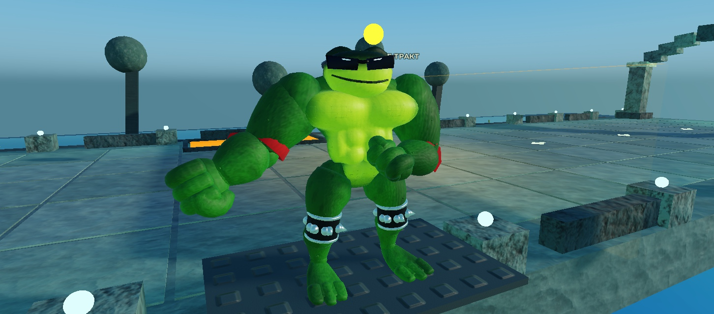

# Green brawler and source-frame presentation — 9 November 2026

The green hero now uses the owner's muscular brawler description in the actual game: broad sculpted chest/abs/shoulders, small low-set head, angular sunglasses and smirk, forest-green/lime skin, red cloth wraps, and dark knee cuffs with silver rims/rivets/spikes. This is an authored3D adaptation, not a claim that a3D skeleton or these materials were extracted from NES. P2 remains the earlier source-palette prototype; Brown and other families remain unfinished.

## Shipped in this slice

- Real Roblox Model asset `98446273547261`, Approved/Active. Final `green-brawler.glb` SHA256 `22c949f45a084f68dd61053cd9e62c2651cb8d351bf124c9eb2a23347a0fe543`,16,143,164 bytes. Fifteen cosmetic segments,53,400 triangles,160,200 UV-split vertices, maximum13,092 triangles/39,276 vertices in one segment; one material and three2048² baked maps. Official Khronos validation: zero errors/warnings/infos. Physical R6 body, health and collision rules are preserved.
- Actual imported IDs, CFrames, source mesh extents,28 attachments and15 SurfaceAppearance objects are saved in `assets/characters/canonical-hero/roblox-player1.json`. The source mesh extent is serialized as `InitialSize`, separately from the scaled part size; both P1/P2 retain positive native `MeshSize` when reopened. Omitting that field previously produced thin/invisible geometry despite correct bounds and joints. Regression and real-file reopening caught/fixed it.
- Canonical idle/walk/run and seven accepted hero actions now drive14 cosmetic joints from the traced source graphics-frame streams. Angles, gait distance and a60-call/s local phase0/Read clock are explicit3D presentation calibration. Commands such as E2 never cause additional damage. Priority/unsupported states retain the previous R6 retargeting. Imported Y180 rest frames use attachment-local rotation order; native matrix regressions reproduce the former backward punch and prove the correction.
- Equipped clubs attach to the visible canonical palm with wrist-axis compensation. All seven equipment welds follow the hand; server ownership is repinned after assembly. Legacy/stale resources keep their established fallback.
- Front-facing bust portraits are rendered from the actual frozen GLBs. Green image `81768891375221` rendered in the native mobile menu. P2 image `112046401281853` was Approved but its thumbnail was unavailable at the captured startup, so its local portrait remained visible; P2 portrait loading is not accepted by this report.

## Verification

All44 native/Python/build commands and compilation passed; see `final-validation.json` and `.txt`. Independent review checked final GLB/rig/manifest transforms, both negative controls for rotated rest frames, lifecycle cancellation, seven clip mappings, club fallback and UI loading guards. The user's `places/BrickToads.rbxlx` stayed at SHA256 `1974f25e1af043f3d4a1fe581b5ec9ac818394ac4bc7a747e6fe0ca1f7b5c353`.

Fresh serialized-file native tests verified both fifteen-mesh templates,28 connections, PBR data and nonzero source extents. A prepared isolated `World:spawn` fixture verified Walk16/Run24, running jump, all seven source action frames, reaction cancellation, health37 retention/other actor100, body replacement and manual server ownership. Maximum observed joint separation was about`2e-5` stud; club grip error was zero during idle and swing. This is prepared engine acceptance, not a complete normal-input combat route. Ordinary native desktop mouse actions separately started Mr. Green and accepted HeroJab/Recovery; the miss feedback was expected with the enemy out of range.

Final source receipt: `a12a84d108eba5bac1ff201d08cf08e20860fd4a24221a622f62acb3a8bbdb9e` (39 scripts). Final playable: 685732 bytes, SHA256 `80c8dc178fa87a274ab4f4ddacc9566624465e2e0c11ea93ddc346ff2bcef36f`. The final file was independently reopened after the front-portrait ID change; the core native movement/attack fixture used identical runtime with the earlier model-thumbnail IDs. iPhone17Pro portrait/landscape layouts were checked in Studio with a normal group-scoped Start envelope; this does not prove physical multitouch.

## Limits

Oversized fist/boot morph geometry, boss fear32/33/full appearance/camera sequence, airborne/death/carry/weapon source-pose parity, the third hero, remaining families and bosses, all13 modes, normal-input full-route clear, physical-device/performance budgets, multiplayer/real reconnect and public-experience asset permissions remain open. No public game release was performed.

The retired material study `111493666857808` is not the runtime resource: Roblox ignored its vertex colours under SurfaceAppearance and imported an invalid emissive reference6. The final file bakes colour into albedo, omits COLOR_0/emissive, and preserves the exact geometry/joint transform fingerprint. Initial transient texture-representation generation messages were observed for newly uploaded content; final colour was checked in Studio and the native game.
