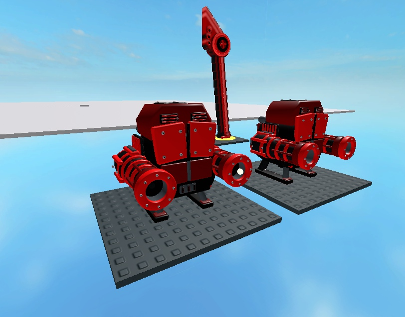
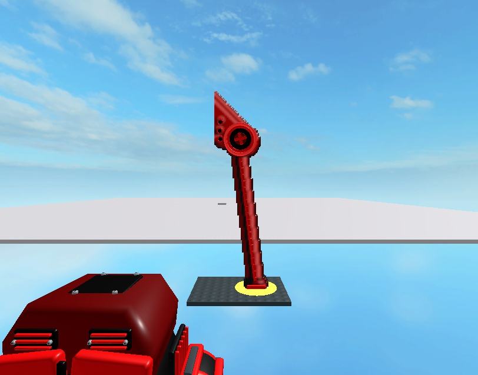

# Guardian cosmetics and slender intro leg — 9 November 2026

The first Guardian now uses three imported red/black mechanical meshes: a chassis and two independently recoiling cannons. The intro uses the slender red source12 leg with its small toe and upper joint/plate instead of the broad boot proxy. Existing R6 physics, projectile origins, damage, controls, life and ownership rules remain authoritative.

## Source and assets

[The source research](../../research/canonical-visuals/BOSS_WALKER_SOURCE.md) verifies two camera-relative cannons10, reticle11, glassC7 and intro leg12. The external chassis, rear anatomy, material RGB, 3D depth and battle composition are authored reconstruction. The reticle is not a physical reactor eye; no invented eye/crown/shield coils are added. HUD reticle/glass and boss audio remain unfinished.

- One approved Model upload: **103948186317063**. Imported albedo atlas: **90154814086213**. Four meshes in [the actual manifest](../../assets/characters/canonical-hero/boss-walker-roblox.json), packaged as two private ServerStorage.BrickToadsBossTemplates resources.
- `boss-walker.glb`: **3,821,508bytes**, SHA256 **4f1d852e369f83da380dd05b37a5d999886aea036eba220852678ed4a47adc08**. Triangles6,704/7,324/7,324/13,284; one baked albedo/material and one primitive per mesh, no COLOR_0/emissive. Official Khronos validator reports0 errors/0 warnings/0 infos.
- Battle bounds **8.968×8.419×8.939studs**, minimum localY−3. Intro leg **6.365625×23.28×3.12**, minimumY0. MountsX±2.5/Y.7/Z.5 and muzzle centresX±3.1/Y.7/Z−4.6 retain the actual imported rest axes. Layout offsets/package yaw were removed and all four measured centres/extents checked before normalization.
- Native MeshSize is serialized separately as InitialSize. Metal is preserved as verified enum1088. Source GLB hashes, exact resource names, attachment axes, side/forward tolerances and nested content are checked before packaging/use.

## Verified snapshot

Source **d6ada582f21045fc2035b5a81bc6ff97ae32be427f8af521df04aaa6c8e03923**,42 scripts. Playable **777,545bytes**, SHA256 **668d4e363410366edaf0ad24265f6f8da7ca90067ffc1cc2925ec46b906114d8**. This snapshot precedes the owner's subsequent wider-mouth correction; its exact file was reopened in a fresh Studio for the evidence below.

`final-validation.json` records **47 successful native/Python/build commands** and compilation of **126 Luau files**. Focused checks include GuardianAppearance9 groups, imported intro16 cases, GuardianPattern14 plus Session4, existing intro13 and serializer31. Independent review found an imported-leg nested-content gap; RED tests reproduced it, and validation now rejects descendants/duplicate metadata/invalid meshes before cloning. Additional RED/GREEN regressions align serializer muzzle axes/clearance with runtime and preserve Metal. Scoped re-review is clean.

`studio-engine-fixture.luau` uses real Session/Director/World/GuardianPattern modules, with explicit fixture positioning/support, direct initial HP preparation and manually advanced time. It does not represent a complete ordinary-input route.

- Counter100 used **one imported leg plus two impact markers**; FF removed it and spawned the imported Guardian, without the generic model. The Guardian preassembles3 meshes/3 motors/2 flashes/2 welds before ownership assignment. Two physical colliders remain. Shot/damage updates add no parts.
- A successful actual Pattern.fire call activated only the left recoil/flash; blocked melee produced neither new firing nor a fabricated hurt cue. The accepted Heavy shot used the other cannon. Source recoil counter7 is represented by an explicit local7/60s calibration and.25stud displacement.
- Settled initial/bullet samples had maximum joint-position error2.39e-7stud and muzzle-weld error0. Other samples may precede the next native joint solve; no blanket zero-error claim is made.
- Actual Pattern.interact pickup/throw and finite projectile stepping resolved three returned Heavy impacts. Boss raw Life followed **47→31→15→0**, normalized display1→2/3→1/3→0, then stageExit. Tint, flashes and recoil returned to their original state between nonlethal rounds.
- The prepared physical hero HP37 and other hero100 were retained, with attempt1, three respawns and Human assignment999. HP37 was directly prepared; this is not an incoming-damage test. Manual server ownership and physical root remained stable. Another party's Guardian retained zero shots/full normalized health.

The images below are separate **Edit native resource/FK inspection scenes** with real module pose writes, not ordinary gameplay footage. Initial warmed captures were blank while meshes loaded; subsequent native fetch statuses were Success and the saved images show the loaded geometry/materials. Cold device loading/performance is unaccepted.

## Limits

The six earlier GLBs remain unchanged. The user's dirty places/BrickToads.rbxlx remains byte-identical at SHA1974f25e1af043f3d4a1fe581b5ec9ac818394ac4bc7a747e6fe0ca1f7b5c353 and is excluded from commits. Default builds use normalized unlinked templates; reinserting the raw uploaded package retains its original export layout/units and requires normalization again.

This accepts a cosmetic checkpoint and prepared encounter, not source-perfect external anatomy/projection, all characters/animations, physical mobile input/performance, a full ordinary-input route, real multiplayer/reconnect,13 modes/six complete bosses or production/public release.
