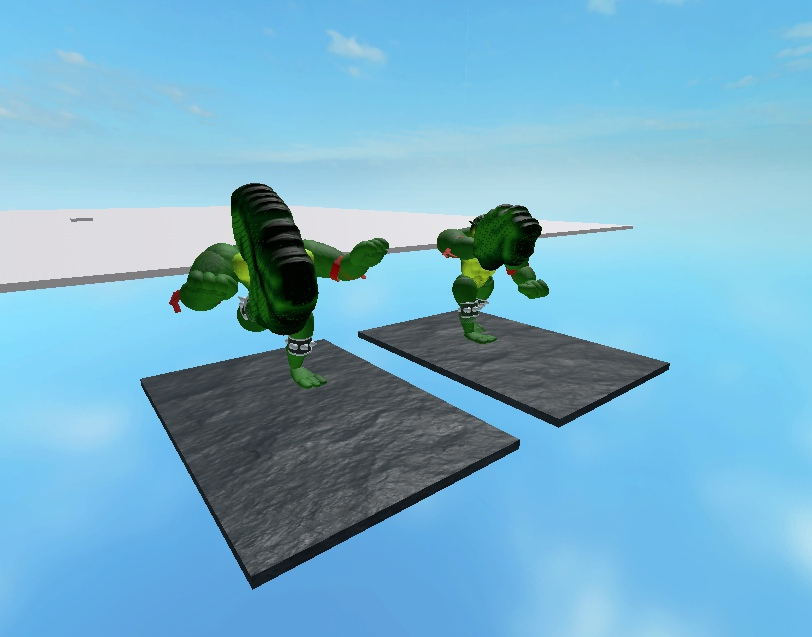
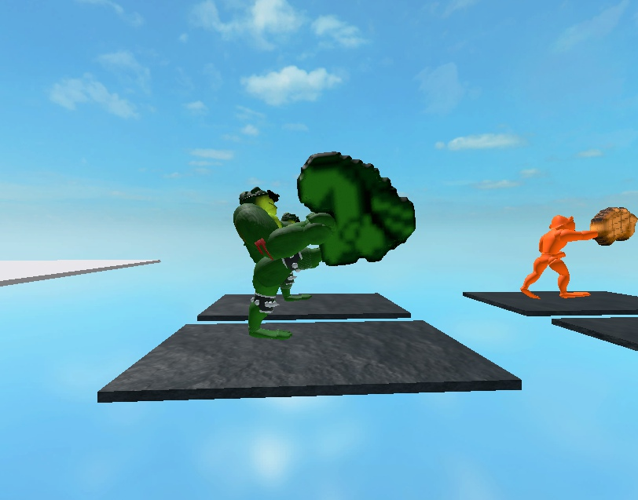
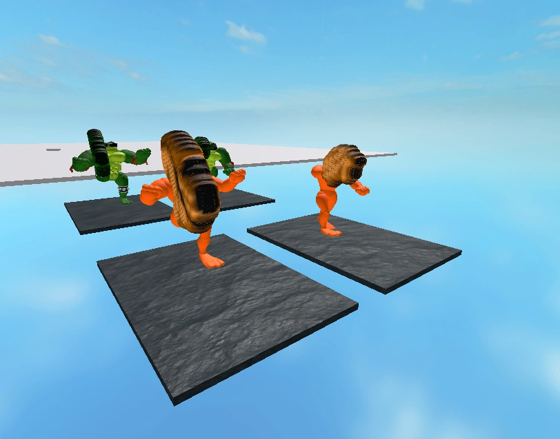

# Hero power fist and big boot — 9 November 2026

The green hero and P2 now show actual enlarged cosmetic meshes during verified source graphics frames: PowerFist on1C, BigBoot on1E. Source1F remains the folded-leg windup with an authored joint pose. Both morphs are preassembled before server ownership is pinned; attacks only change visibility. No combat, damage, collider, life-resource or movement rule changed.

## Frozen assets and build

- Approved private Roblox Model: **134209153804955**, imported through Studio MCP/Open Cloud from the already-approved hero directory. Four independent meshes with actual mesh/texture IDs in `assets/characters/canonical-hero/roblox-attack-morphs.json`.
- `hero-attack-morphs.glb`: **7,368,376 bytes**, SHA256 **250a7dec19adba96c735b55164fc4d4e1fef9b5a595ce4fac59e8852dbc79f0e**. Four nodes,52,836 triangles total; maximum15,028 triangles per mesh; one baked albedo material. Official Khronos validator:0 errors,0 warnings,0 infos.
- Source fingerprint: **4492378ddb9f182c5b6f9f2eec637ef9f6251b0a82e6f25bf5c86bc9074e2f31**. Playable file: **709,192 bytes**, SHA256 **4665511bf5be24e380744235f5342c1a0170052ce5ec75bcee96ef420a0b79d7**. The exact serialized file was reopened in a fresh Studio.
- The user's dirty `places/BrickToads.rbxlx` remains byte-identical: SHA256 **1974f25e1af043f3d4a1fe581b5ec9ac818394ac4bc7a747e6fe0ca1f7b5c353**. All four pre-existing character GLB files remain unchanged.

## Native verification

`final-validation.json` records **44 successful native/Python/build commands** and compilation of **118 Luau files**. This includes15 pure source-presentation tests,10 morph preparation/lifetime contracts, the existing appearance/rotated-rest/world suites and21 playable-builder tests. Builder regressions reject an origin residual of.0005 and a fully transparent source morph. Independent review found no remaining blocker in the reviewed runtime, asset and packaging changes.

`studio-engine-fixture.luau` and `studio-engine-evidence.json` record a **prepared native World/server fixture**, with the accepted-action clock advanced explicitly. It is separate from normal player-input acceptance:

- Each living hero has17 cosmetic MeshParts/17 cosmetic Motors plus6 existing physical R6 Motors; two physical colliders remain. Morphs are massless, unanchored, and have collision, touch and query disabled.
- Source1C displays only PowerFist and hides only the normal right hand. Source1E displays only BigBoot and hides only the normal right foot. Source1F shows neither morph. Source end restores the normal hand/foot.
- Two heroes retain independent morph state. Reaction, club, absent context, dead-state priority and an actual native jump restore ordinary limbs. A pre-existing hand transparency of.25 is restored exactly.
- Morph joint position error was0 in captured samples. Manual server network ownership and the physical root remain unchanged through active/inactive transitions. Damaged hero HP remains37, the other hero remains100 before body replacement.
- Replacement destroys the old body, creates a clean inactive appearance and leaves the other body intact. New-body health follows the existing spawn rule.
- An initial added fixture assertion expected the label `Death`; the real World contract is `Dead`. Correcting that fixture expectation, without changing game code, produced the stored passing run.

The initial instant visual capture occurred before resource download and was blank. The three saved images below were captured after actual native geometry/texture loading. `studio-visual-fixture.luau` samples the real presentation module and solves its native Motor6D transforms in Edit for stable front/side review; it is not a screenshot of ordinary gameplay or a Play physics test.

## Remaining work

Silhouette inputs and source-frame identities are verified against the pinned disassembly. Three-dimensional depth, attachment anchors, right-limb selection, joint angles and60-call presentation calibration are explicitly authored adaptations. P2 retains its earlier prototype body; these morphs do not finish that character. Folded1F geometry, other source morphs, boss fear/entrance, airborne source motion and remaining character states are unfinished.

This checkpoint does not accept cold first-attack loading, memory/performance on physical phones, touch play, a complete normal-input route, multiplayer/real reconnect, all13 modes/six bosses or public release. BT-14 and BT-62 remain In Progress. The separate public BrickToads experience has not been published.
