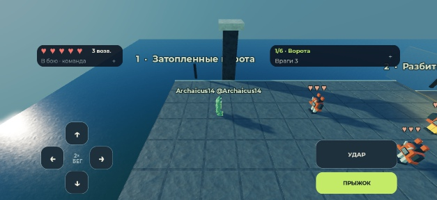

# Ходьба, бег и компактный мобильный HUD

Текущий playable: **434044 байта**, SHA256 `12a14dc9a8e6972e033d093f45d512d0dca23656a927775f90c29cdd26ed11cd`; source receipt `ca590a35b8ea4f9b6f2280490886117a4779cb338345ca6fe44d91692f94e96a`. Все31 production-скрипт после проверок точно совпали в Studio. Стартер пользователя сохранён отдельно и исключён из коммита.

## Что изменилось

Удержание направления — ходьба; двойное нажатие с удержанием за0.25с — бег. Герой16/24 studs/s, обычный наземный враг9/16. На мобильном четыре кнопки направлений, прыжок и основной удар используют стандартный Roblox Input Action System с Automatic UIButton bindings. Удар с фактического разбега выбирает мегаатаку; R стоя отклоняется. Сервер проверяет движение, опору, свежесть ввода и состояние тела; скорость от отбрасывания не выдаётся за бег. В прыжке сохраняется лимит скорости отрыва, без воздушного включения бега и повторного прыжка.

На touch-экранах постоянно видны только личное здоровье/возвраты и краткий прогресс: две панели44px. Подробности команды/задачи открываются по нажатию и сворачиваются явно; по умолчанию они закрыты. В узком портрете панели идут в две строки. Маленький landscape использует свободный промежуток между кнопками для явно открытых подробностей; область прокрутки остаётся ненулевой. Приглашение в очередь стража имеет приоритет. Обе ориентации сохранены по последнему указанию пользователя. Первичные touch-кнопки не меньше44 логических пикселей.

Решение опирается на проверенные9ноября2026 рекомендации [Roblox](https://create.roblox.com/docs/tutorials/use-case-tutorials/ui/create-hud-meters), [Apple](https://developer.apple.com/videos/play/meet-with-apple/243/) и [Android](https://developer.android.com/design/ui/mobile/guides/layout-and-content/layout-basics); ссылки и выбор описаны в [плане](../../docs/superpowers/plans/2026-11-09-mobile-hud.md).

## Доказательства и границы

- [Полный native/Python набор движения](final-validation.json):34/34, compiler91; MovementInput13, RunningCombat18, world38, feedback12. Это source-снимок `a3ea0a31…` до UI-доработки.
- [Финальный focused HUD набор](mobile-hud-validation.json):5/5 и compiler91 на `ca590a35…`, включая Input13, RunningCombat18, Feedback12, packaging8 и точную сборку. Lua5.4 отсутствует и не засчитан как PASS.
- [Studio UI](mobile-hud-studio.json): iPhone landscape750×381/portrait401×778, GalaxyA06 landscape705×338, iPad1375×1032; снимки, размеры и TextFits. Обычный native тап Goal открыл подробности при удержании D: Right=true и input context=true. Повторный тап закрыл их. Все31 source совпали после очистки временных наблюдателей.
- [Стандартные UIButton bindings](native-ui-bindings-engine.json): native Right одновременно с F/Space, отпускание действий сохранило Right, отпускание Right сбросило его. Это virtual mouse+keyboard, **не физический multitouch**. [Отдельная неудачная follow-up попытка](mobile-run-attempt-not-accepted.json) с выключенным контекстом не засчитана.
- [Ходьба](walk-jump-engine.json) и [бег/мега](run-mega-jump-engine.json), короткие обычные клавиатурные пробы: реальные cap/vx16 и24, смещение до первого устойчивого приземления10.1332 и14.7998studs при том же JumpPower50. Primary Punch принят как Dash, затем AttackMiss; попадание героя здесь не заявлено. Снимок `a3ea0a31…`.
- [NPC](npc-running-strike-engine.json): EnemyRunStrike Walker→Pig, ordinary profile4/raw16, Life15→0. Поздние кадры Idle/cap9 не доказывают скорость NPC16 в момент раннего удара.

Независимое ревью выявило и закрыло промах Walker на6.25studs и перекрытие очереди стража подробностями; финальный обзор не оставил блокирующих замечаний. [Предыдущие геометрия/клавиатурный маршрут](../2026-11-08-keyboard-route/README.md) сохранены отдельно. Отменённая автоматическая Cliff-траектория не возвращалась: прыжок выбирает игрок. Нового полного прохождения, двух/трёх клиентов, реального reconnect и физических телефона/планшета не было; BT-25/26/61 этим не закрываются.

[Портрет](screenshots/iphone17-portrait.png) · [небольшой Android](screenshots/galaxy-a06-landscape.png) · [планшет](screenshots/ipad-pro-landscape.png) · [подробности по явному нажатию](screenshots/iphone17-open-details.png)
