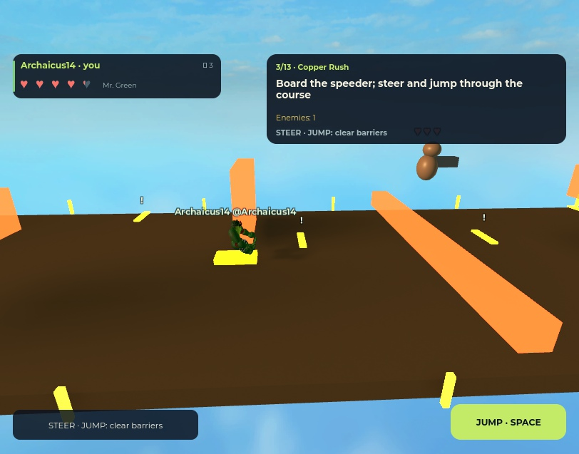

# Copper Rush acceptance follow-up — 9 November 2026

BT-29 remains in **Review**. This checkpoint fixes defects exposed while progressing from prepared boundaries to full native courses. Physical phone/tablet multitouch and a genuine multi-client solo/duo/trio role matrix are still unverified; three bodies with synthetic co-owners are not three connected clients. BT-28's completed specification remains separate from those acceptance requirements.

## Saved release

| Item | Receipt |
| --- | --- |
| Playable | `places/BrickToadsPlayable.rbxlx`, 1,020,211 bytes |
| Place SHA-256 | `1102ac79b23efc210a1fdd4bad6907bde9d883cbcab0cbb468213b00a70d40df` |
| Packaged source SHA-256 | `b6b12b3ad99311bf937fb556fe9445a40efd0c4cec71cdb9feae3c7475447cff` |
| Packaged scripts | 50 |
| Protected user starter | `1974f25e1af043f3d4a1fe581b5ec9ac818394ac4bc7a747e6fe0ca1f7b5c353`, preserved and excluded from staging |

The earlier [campaign checkpoint](../2026-11-09-campaign-mechanics/README.md) remains historical. Its source38b and native results have not been relabelled as this release.

## Corrected behavior

- A human or NPC Invader now retains its own finite escape deadline after the victim dies or receives another body. Removing an invalid Life-return link cannot leave an immortal entry blocker. Escape consumes its carried token before ending the thief's life; it does not heal a replacement hero.
- The authored entry Invader moves from X12 to X28 on the existing supported ledge. Its ordinary 9 studs/s approach leaves the initial claim offer visible; normal range entry and accepted attacks still close transfer. No alert pause or mid-fight claim exception was added.
- A RocketRat type29 obstacle hitting a mounted hero now uses the existing crash/group rewind policy, including spawn protection. It no longer applies an ordinary raw16 hit. Synchronous rewind may remove multiple effects; iteration safely skips removed entries instead of dereferencing them.
- Speeder now has a continuous physical road matching its already flat logical riding surface. The road overlaps entry/finish and covers both lane limits plus body clearance. Jet/Surf geometry, obstacle order and player steering/jump decisions are retained.
- Mounted hero Speeder/Surf/Jet HUDs hide unavailable Attack/Mega and ground-running prompts while retaining valid jump/lift. Clinger shows directional controls. Boarding/finished heroes, linked Dragon fire/dismount, carry/throw, Rope kick and human RocketRat Drop retain their own actions.

## Verification

[Full command log](final-validation.txt) and [structured results](final-validation.json): **56/56 commands PASS**, **161 Luau compilations PASS**, build/source receipts match and sources did not change during the run. The separate [client visibility check](ui-validation.json) executes the actual render block for desktop/touch role snapshots; it passes. It is an extra command, not included in the56 total. Both new runners are included in GitHub CI.

Meaningful RED/GREEN checks cover the lost escape deadline, first-snapshot offer with an actually integrated 9 studs/s approach, and the actual RocketRat projectile crossing a mounted hero. The integrated collision runner verifies a paid duo crash, synchronous two-projectile cleanup with three heroes, and a protected contact that causes no damage, impulse, shield extension or extra rewind. Mode checks now total84; enemy contracts34. The new road test checks support across the entire riding interval and lane edges for five seeds; seeded obstacles and the mounted exit requirement remain covered.

## Native whole-course matrix

The exact saved file was opened in owned helper process **15632**, Studio **`3eb64ea8-6d2e-4f9c-8925-c53069d1da76`**. For access, this helper received the test-only [acceptance module](../../tools/studio_scooter_acceptance.luau) and one startup call. The source receipt above identifies the packaged base, not a recalculated fingerprint of that instrumented helper. Production gameplay/client modules are unchanged by this access hook. No helper is packaged in the playable.

Preparation creates a new run with one actual client plus selected synthetic co-owners and explicitly selects stage3 through the existing transition functions. After preparation, the pilot issues validated movement, jump and primary intents only. The actual production controller heartbeat, native actor physics, entry Invader fight, boarding, scripted RocketRat, obstacles, checkpoint progression and earned transition execute normally. The pilot writes no health, lives, body poses, course geometry or forced outcomes during the course. This is an automated native course test, not a human or multi-client playthrough of the full campaign.

[Raw matrix and position/resource traces](native-course-matrix.json): **9/9 passed**.

| Seed | One hero | Two heroes | Three heroes |
| --- | --- | --- | --- |
| 1 | 14.621s | 15.144s | 15.066s |
| 41 | 14.628s | 15.082s | 15.049s |
| 8125 | 14.637s | 15.142s | 15.163s |

Every course reaches the next stage with all original hero ActorIds, attempt1 and all three respawns. The setup/initial/current snapshots and sampled traces are retained for each run.

## Actual UI and keyboard path

The normal Start button was clicked through native mouse input. Stage3 was then selected as explicit test preparation. The [first offer receipt](native-first-offer.json) shows an Invader offer both after the first client broadcast interval and at **1.049s**, on the same enemy body.

The [keyboard receipt](native-keyboard.json) uses actual native W/A/S/D, F and Space input through the production IAS, client remotes and controller. From its first keyboard observation to the earned stage4 transition it takes **13.882s**, visits checkpoints1/2/3 and preserves the same actor, attempt1 and three respawns. During the idle offer observation, the Invader naturally stole raw8 and escaped; keyboard driving starts at Life39. The normal next-level transition restores47. No health/body/life/geometry writes occur during this input probe. This keyboard run does not establish a human-controlled Invader fight; the nine courses above separately cover entry combat.

The [production controller journal](native-controller-journal.json) records the matching run's real lifecycle events. At the mounted native observation, Attack=false, Mega=false, Jump=true and the hint is `STEER · JUMP: clear barriers`.

This is a desktop capture, not a physical-phone or final-art acceptance image.

## Prepared native role boundaries

[Replayable probe](studio-role-probes.luau), using the earlier campaign fixture as documented in its header; [results](native-role-probes.json):

- **Human RocketRat/drop:** entry actors are removed for isolation, initial protection expires, actual validated boarding occurs, and three existing riders are positioned once near the existing scripted encounter. The same rat body is claimed; actual Punch drops its obstacle and a second request returns `NO_AMMO`. Real-clock native collision produces Stopped → rewind → Riding, serial1. Only the collided hero pays a respawn: stocks2/3/3. Both survivors keep their bodies/attempts/Life47. No encounter projectile remains after rewind.
- **Human Invader/victim replacement:** after a same-body claim, initial shield wait and one prepared victim stance, validated movement/attack steals exactly raw8 (47→39). A victim death is then explicitly injected through Session to isolate replacement, not earned by a claimed combat win. The paid replacement becomes attempt2/stock2. The thief still escapes at its original deadline and no stale refund heals the new body.

These are prepared native domain/physics probes; they do not represent multiple connected human clients.

## Cleanup and original Studio

Temporary fixtures were cleaned, the helper stopped and process15632 closed after verifying its exact file path. Earlier owned preview helpers29752/4844 were also closed. The user's original process24008 remains open in Edit.

Original Studio sources were compared exactly before both updates; all50 final sources/classes were compared exactly against the saved release after application. Temporary source staging was removed. No acceptance helper was installed in the original Studio, and the dirty user starter was not saved or staged. Existing GLBs/imported character resources remain untouched. Public publishing, full natural thirteen-stage human play, real-device performance and actual reconnect remain open.
