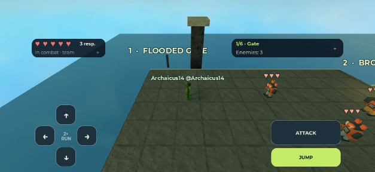

# Copper Rush: actual Studio client acceptance — 9 November 2026

This checkpoint replaces the earlier synthetic co-owner limitation with actual Studio client processes for the hero/NPC course. It does not establish physical mobile input, human enemy-role acceptance, network impairment tolerance or public-release readiness. BT-29 remains in Review; BT-27 remains In Progress.

## Saved game and test setup

- Production source: `b6b12b3ad99311bf937fb556fe9445a40efd0c4cec71cdb9feae3c7475447cff`.
- Unchanged playable: `places/BrickToadsPlayable.rbxlx`, **1,020,211 bytes**, SHA-256 `1102ac79b23efc210a1fdd4bad6907bde9d883cbcab0cbb468213b00a70d40df`.
- Native Studio: **0.746.0.7461269**; local syntax/regression runner: pinned Luau **0.745**.
- Seed **41**, scenario `Heroes`, six Studio network delay/jitter/loss settings **zero throughout**. These are local baseline tests; command round trips are not Internet ping or mobile performance measurements.
- Owned helper: PID **13840**, MCP Studio `4dc89b99-dca4-45c2-a110-30af7be32f58`. The user's original Studio `67cde5d7-c587-4240-9f6f-ef46082fa9bc` / PID24008 was not used for these tests.

The owned helper contains the test-only server module, client driver and one startup call. They are not packaged in the playable. The server checks its expected BuildId exactly. Each participant must be the current actual `Players` instance and share the group/world. A client-side `FireServer` call is never treated as immediate server acceptance.

[Replay instructions](../../tests/scooter_network/README.md) · [server harness](../../tools/studio_scooter_network_acceptance.luau) · [client driver](../../tests/scooter_network/Client.client.luau) · [launcher](../../tools/studio_launch_scooter_network.luau).

Actual clients select their roles/heroes and Start through the production Intent remote. The server explicitly selects seed41 and advances to stage3. Thereafter the pilot uses client Move/Attack/Jump envelopes only: entry patrol fight, boarding, steering, obstacle jumps, checkpoints and the earned stage4 transition run through the real controller and native world. The test writes no health, body pose, geometry, stock or forced result during the course. Presentation/input UI is disabled in these clients so the test owns the sequence; this is automated remote acceptance, not human UI play.

## Completed course results

| Actual clients / heroes | Result | Checks | Stage3 preparation to earned clear | Whole test including client startup |
| --- | --- | --- | --- | --- |
| 1 | PASS | 47 | 16.886s | 50.418s |
| 2 | PASS | 85 | 16.847s | 65.352s |
| 3 | PASS | 114 | 19.283s | 80.473s |

[One-client raw receipt](heroes1-rendered.json) · [two-client raw receipt](heroes2-rendered.json) · [three-client raw receipt](heroes3-rendered.json) · [compact summary](course-summary.json).

All six participating heroes across these three runs reached checkpoint3, produced four accepted jump events apiece, steered and preserved their stage3 ActorId, attempt1 and all three respawns across the earned transition. Final raw Life is47 under the normal next-stage restoration. All clients received the same group/run/epoch transition, saw their own preserved physical body and ended the pilot with `StageChanged`. The three-client riders reached X425.76/428.07/428.07 before the first-finisher transition; no stationary teammate was counted as having traversed the course.

Measured test Command→Reply median/p95: **47.7/608.9ms** solo, **48.4/379.0ms** duo and **72.9/1214.8ms** trio. Maximums were626.3ms,1227.9ms and1745.1ms respectively. These include test processing and local Studio scheduling; they do not establish public-network latency or a performance budget. Each real client needed32.1–57.8 seconds from server startup to the final readiness barrier.

Production advances the team after its **first finisher**, as specified. The acceptance observer independently requires **every** hero to board, receive actual server mode input and reach at least X389 (`finishPoint.x - 45`) before that transition. Quarter-second authoritative position/checkpoint traces and accepted jump events are retained. Sequence high-water is labelled as a consumed validated envelope, not proof that every submitted action succeeded.

The one-client receipt predates the final finite-timestamp filter for the observer: its initial default `input.at=-inf` is retained as an engine JSON numeric marker. It also contains many finite inputs and four separately accepted jump events. The final harness omits this initial sentinel from input counts and traces; the historical receipt is not rewritten.

## Startup failures retained

- [Initial45-second readiness deadline](heroes3-startup-ready45-fail.json): failed before gameplay; cold client scripts started after the deadline. The startup allowance was changed to90 seconds from the measured log timing; the overall server watchdog is180 seconds.
- [Snapshot-only readiness](heroes3-startup-ready90-fail.json): all three actual clients became ready, but only two answered the first Menu command. This receipt cannot establish the missing command's cause.
- [Armed-listener readiness](heroes3-ready-barrier-fail.json): all three answered role selection, then Player1 did not receive its hero-selection command. The [owned Player1 log excerpt](player1-cold-start-timeline.txt) records Studio view/render initialization and a main-thread hang after its earlier Ready/reply. This supports a cold-start scheduling explanation; no production gameplay fault was demonstrated.

The final client publishes Ready only after an ordered production snapshot, an armed Command listener and two rendered frames. Bounded one-second heartbeats distinguish rendering, snapshot and command/reply progress. Requests retain sender identity and received/missing reply evidence even when they time out. The reply deadline remains10 seconds; no automatic retry conceals a missing command.

The [original ordering RED/GREEN receipt](client-ready-order-validation.json) and [render-barrier regression receipt](client-render-readiness-validation.json) execute the actual client source with deterministic scheduling doubles. They verify the driver contract; they do not simulate Roblox networking. [Local validation](local-validation.json) records all three script compilations, both readiness cases, the unchanged playable build check and file hashes. CI now also compiles the helper scripts and runs the readiness regression.

## Mobile preview and remaining acceptance

[Device receipt](device-baseline.json): Studio's dynamically listed iPhone17Pro emulator, landscape, logical camera750×381, touch enabled. The compact status strips and four-button D-pad leave the central game view clear. This is a visual preview; simultaneous physical touch was not established. The temporary input-coordinate investigation did not produce a successful multitouch receipt. Device simulation was restored to default; network settings were not changed.

Still open: physical phone/tablet multitouch and performance; gamepad; the corresponding real-client human Invader/RocketRat role/crash matrix; an actual same-account reconnect into the same server; full natural campaign/art/audio acceptance. Prior prepared native role probes remain in the [earlier scooter report](../2026-11-09-scooter-acceptance/README.md) with their original scope.

The protected user starter `places/BrickToads.rbxlx` retains SHA-256 `1974f25e1af043f3d4a1fe581b5ec9ac818394ac4bc7a747e6fe0ca1f7b5c353` and is excluded from this change. [Cleanup receipt](cleanup.json): all test children exited through EndTest, then the owned helper was closed after its exact file path and process lineage were verified. The original Studio remains open in Edit. No production code or character assets changed in this checkpoint. Public publishing was not performed.
